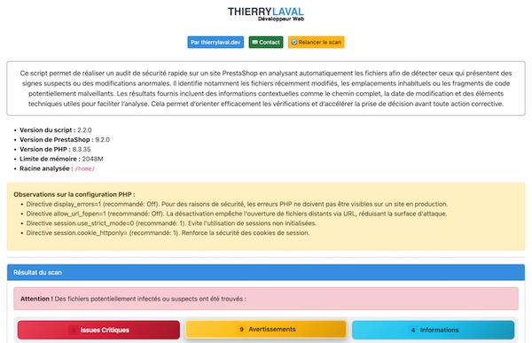

# 

### 👤 Auteur

👤 **Thierry LAVAL** — [Contact](mailto:contact@thierrylaval.dev)

* GitHub : [@Thierry Laval](https://github.com/thierry-laval)
* LinkedIn : [Thierry Laval](https://www.linkedin.com/in/thierry-laval)
* Site Web : [thierrylaval.dev](https://thierrylaval.dev)

---

### 📎 Projet

**PrestaShop Security Scanner** — Scanner de sécurité pour PrestaShop : audit automatique des fichiers, de la configuration et des en-têtes HTTP.

_Script monofichier `scanner.php` (+ `data/skimmer-domains.txt`)_ — Version : **2.2.0** · Licence : **AFL-3.0**
_`Début du projet le 30/09/2025`_



### Table des matières

1. [À propos du projet](#à-propos-du-projet)
2. [Fonctionnalités](#fonctionnalités)
3. [Prérequis](#prérequis)
4. [Installation](#installation)
5. [Configuration](#configuration)
6. [Liste blanche (faux positifs)](#liste-blanche)
7. [Données stockées](#données-stockées)
8. [Emplacement des données](#emplacement-des-données)
9. [Base de données](#base-de-données)
10. [Fichiers et répertoires importants](#fichiers-et-répertoires-importants)
11. [Sécurité](#sécurité)
12. [Protection du répertoire](#protection-du-répertoire)
13. [Configuration Apache / Nginx](#configuration-apache--nginx)
14. [Variables d’environnement et configuration](#variables-denvironnement-et-configuration)
15. [Identifiants et comptes](#identifiants-et-comptes)
16. [API et services externes](#api-et-services-externes)
17. [Utilisation — Interface web](#utilisation--interface-web)
18. [Utilisation — Ligne de commande (CLI)](#utilisation--ligne-de-commande-cli)
19. [Moteur de détection](#moteur-de-détection)
20. [Scans externes gratuits](#scans-externes-gratuits)
21. [Sauvegarde](#sauvegarde)
22. [Mise à jour](#mise-à-jour)
23. [Désinstallation](#désinstallation)
24. [Dépannage](#dépannage)
25. [Logs et diagnostic](#logs-et-diagnostic)
26. [Architecture](#architecture)
27. [Sécurité en production](#sécurité-en-production)
28. [Avertissement](#avertissement)
29. [Résumé de l’installation](#résumé-de-linstallation)
30. [Limites connues](#limites-connues)
31. [Feuille de route](#feuille-de-route)
32. [Licence](#licence)

### 📖 À propos du projet

**PrestaShop Security Scanner** est un script PHP monofichier qui effectue un audit de sécurité sur une installation PrestaShop. Il analyse récursivement les fichiers afin de détecter ceux qui présentent des signes suspects ou des modifications anormales, puis vérifie plusieurs aspects de la configuration du serveur : permissions dangereuses, en-têtes HTTP de sécurité, directives PHP sensibles, extensions requises, `.htaccess` racine et version de PrestaShop.

Le script s’utilise de deux façons :

* **En navigateur**, avec une interface web responsive (Bootstrap 5) qui présente le rapport, les onglets de sévérité et les boutons d’export.
* **En ligne de commande**, avec un rapport texte coloré, des exports CSV/JSON et des codes de sortie exploitables par un cron ou une CI.

Aucun compte, aucune clé API et aucun service payant ne sont requis. Les scans externes proposés (Sucuri, urlscan.io, securityheaders.com, VirusTotal) sont facultatifs et 100 % gratuits.

> **Emplacement et exposition :** le dossier du projet est prévu pour être déposé **à la base du dossier PrestaShop** (c’est-à-dire le dossier `prestashop-security-scanner/` placé à la racine de la boutique). L’auto-détection trouve la racine par ordre de priorité : dossier du script → sous-dossiers usuels → remontée limitée à 3 niveaux. Le dépôt du script **à la racine même** de PrestaShop fonctionne toujours.
>
> ⚠️ Déposé sous la racine web, le script est **accessible publiquement** par URL tant qu’il reste en place. Supprimez-le du serveur dès l’audit terminé, ou protégez son accès (voir [Protection du répertoire](#protection-du-répertoire)).

Le projet est regroupé dans `scanner.php`. La liste noire de domaines de skimmers est isolée dans `data/skimmer-domains.txt` afin de pouvoir être mise à jour sans toucher au code. La liste blanche des faux positifs ajoutés depuis l'interface est persistée dans `data/whitelist.json`.

> ℹ️ **Périmètre du scan :** le scanner analyse toute l’arborescence PrestaShop, à l’exception volontaire des caches (`var/cache`, `app/cache`), des dépendances Composer (`vendor/`, `node_modules`) et du dossier du scanner lui-même. Les sous-dossiers `vendor/smarty/smarty/libs` et `vendor/doctrine/cache`, listés comme critiques, restent analysés.

### ✨ Fonctionnalités

* **Scan récursif** des répertoires critiques (`classes`, `modules`, `themes`, `override`, `img`, `upload`, `js`, `pdf`, `mails`, `bin`, `tools`, `download`, `app`, `src`…).
* **Plus de 150 motifs malveillants** : backdoors, web shells (`c99`, `r57`, `wso`, `alfa`, `blm`…), skimmers de carte bancaire (Magecart), code obfusqué (`base64_decode`, `eval`, `gzinflate`, `chr`, XOR, hex), injections de superglobales, exécution de commandes (`shell_exec`, `passthru`, `proc_open`)…
* **Détection de PHP dans les dossiers média** (`img/`, `upload/`, `download/`) — hors `index.php` et `config.php` légitimes.
* **Détection des fichiers PHP déguisés** : double extension (`.php.jpg`), extensions alternatives (`.phtml`, `.php5`, `.php7`, `.phar`, `.pht`, `.phps`) et code PHP caché dans un fichier non-PHP (image, `.txt`, `.css`…).
* **Détection des fichiers sensibles exposés** : sauvegardes `.sql`, archives, `.env`, `.git`, `composer.json/lock`, `phpinfo.php`, `adminer.php`, logs…
* **Liste noire de domaines de skimmers** connus (Magecart), chargée depuis `data/skimmer-domains.txt`.
* **Vérification des permissions dangereuses** (World Writable, 777) **+ correction automatique en un clic** (fichiers `0644`, dossiers `0755`).
* **Audit des en-têtes HTTP de sécurité** (HSTS, CSP, X-Frame-Options, X-Content-Type-Options, Referrer-Policy, Permissions-Policy, X-XSS-Protection), avec repli sans `curl` (via `file_get_contents`) pour les hébergements mutualisés.
* **Audit de la configuration PHP** : directives sensibles (`display_errors`, `allow_url_fopen`, `allow_url_include`, `expose_php`, `session.cookie_httponly`, `session.cookie_secure`, `open_basedir`, `disable_functions`) et extensions requises (`zip`, `gd`, `openssl`, `curl`, `pdo_mysql`).
* **Détection des versions vulnérables** de PrestaShop (1.6.0, 1.7.0, 8.0.0–8.0.2).
* **Détection des fichiers modifiés récemment** (fenêtre de 7 jours dans les zones sensibles) — signal fort de compromission.
* **Détection de PHPUnit** exposé dans les modules, **avec suppression en un clic** des fichiers/dossiers `phpunit` détectés.
* **Analyse du `.htaccess`** racine : redirections externes, handlers PHP (`SetHandler`/`AddHandler`/`AddType`), `php_value`/`php_flag` sensibles, `Options +ExecCGI`, `ErrorDocument` local (hors cible 404 standard de PrestaShop `index.php?controller=404`), `<FilesMatch>` PHP.
* **Analyse des `.user.ini`** de toute l'installation (racine + sous-dossiers) : détection de `auto_prepend_file` / `auto_append_file` (chargement de code au démarrage de chaque requête PHP) et des redéfinitions de directives de contexte (`open_basedir`, `include_path`, `error_log`, `session.save_path`). Équivalent PHP-FPM du `.htaccess`, souvent oublié dans les audits.
* **Whitelist dynamique persistante** : envoi d'un faux positif en liste blanche depuis n'importe quelle alerte (fichier exact ou dossier parent), avec onglet « Liste blanche » dédié pour gérer les entrées. Persistée dans `data/whitelist.json`.
* **Bouton « Relancer le scan »** en haut de page, pour relancer un audit complet sans manipulation d'URL.
* **Détection du cache Smarty configuré en MySQL** (`PS_SMARTY_CACHING_TYPE == 'mysql'`).
* **Détection du dossier `/install`** toujours présent (faille critique).
* **Export des résultats** en CSV, JSON et HTML autonome.
* **Scans externes gratuits** (Sucuri SiteCheck, urlscan.io, securityheaders.com, VirusTotal).
* **Interface web responsive** (Bootstrap 5) **et mode ligne de commande** avec codes de sortie.

Rien ne garantit qu’un scan détecte 100 % des menaces : le script **oriente** les vérifications, il ne les remplace pas.

### 🧰 Prérequis

#### PHP

* **PHP 7.4 ou supérieur** (testé jusqu’à PHP 8.5). Le code gère explicitement les différences entre versions (dépréciation de `$http_response_header` en PHP 8.4, inutilité de `curl_close()` depuis PHP 8.0).
* Extensions nécessaires au fonctionnement complet :
  * `curl` — pour l’audit des en-têtes HTTP (méthode 1). Un repli natif via `file_get_contents()` existe si `curl` est absent, à condition que `allow_url_fopen` soit actif.
  * `zip`, `gd`, `openssl`, `pdo_mysql` — extensions requises par PrestaShop ; leur absence est signalée dans le rapport.
* Fonctions standard PHP utilisées : `preg_match_all`, `md5_file`, `fileperms`, `chmod`, `RecursiveDirectoryIterator`. Le script active `pcre.jit` lorsque PCRE JIT est disponible.
* `ini_set('display_errors', 1)` est appliqué **en tête du script** : les erreurs PHP sont donc affichées pendant l’audit. Retirez ou ajustez ce réglage si vous conservez le script en place (voir [Sécurité](#sécurité)).
* `set_time_limit(600)` : le scan dispose de 10 minutes. Sur un gros catalogue, ajustez cette valeur ou la configuration de l’hébergeur.

La version PHP exacte de l’hébergement n’est pas inscrite dans le projet : **à vérifier dans cPanel ou auprès de l’hébergeur**.

#### Hébergement et autres dépendances

* Un serveur web exécutant PHP (Apache, Nginx, LiteSpeed…).
* Un accès en lecture aux fichiers du site à auditer ; l’écriture n’est nécessaire que pour la correction automatique des permissions (`chmod`) et la suppression des fichiers/dossiers PHPUnit.
* Un domaine joignable publiquement **uniquement** pour les scans externes (Sucuri, urlscan.io, securityheaders.com, VirusTotal). Un site local (`localhost`, `127.0.0.1`) ne peut pas être analysé par ces services.
* Aucun Composer, npm, framework, paquet tiers ou compilation frontend n’est présent dans le projet analysé. Bootstrap 5.3.2 est chargé depuis un CDN uniquement pour l’interface web ; le rapport HTML exporté, lui, embarque son propre CSS (aucune dépendance externe).

#### Permissions

* Le processus PHP doit pouvoir **lire** les fichiers du site.
* La **correction automatique des permissions** (`?fix_permissions=1`) nécessite les droits de `chmod` sur les fichiers/dossiers signalés.
* La **suppression des fichiers/dossiers PHPUnit** (`?fix_phpunit=1`) nécessite les droits de suppression (`unlink`/`rmdir`) sur les éléments concernés.
* Sur de nombreux hébergements mutualisés, `chmod` et la suppression sont restreints : l’échec est capturé et affiché, sans casser le scan.
* Le script n’écrit **aucun fichier** sur le serveur : les rapports sont envoyés au navigateur ou à la sortie standard.

### 🚀 Installation

#### 1. Placer le fichier

Le projet analysé contient :

```text
scanner.php
data/skimmer-domains.txt
README.md
LICENSE
```

Deux emplacements fonctionnent (l’auto-détection de racine gère les deux) :

* **recommandé** : déposez tout le dossier `prestashop-security-scanner/` **à la base du dossier PrestaShop** ;
* **classique** : copiez `scanner.php` **à la racine** de l’installation PrestaShop.

Dans les deux cas, `data/skimmer-domains.txt` doit rester dans le dossier `data/`, **au même niveau que `scanner.php`** : le script le cherche via `__DIR__ . '/data/skimmer-domains.txt'`. Sans ce fichier, la détection de skimmers par liste noire est simplement désactivée (aucune erreur).

Ouvrez ensuite le script dans votre navigateur (`https://votre-site.com/scanner.php` ou `https://votre-site.com/prestashop-security-scanner/scanner.php`).

> ⚠️ **Sécurité :** supprimez `scanner.php` (et le dossier `data/`) du serveur une fois l’audit terminé. Ne le laissez jamais accessible publiquement de façon permanente.

#### 2. Configuration

Le script est **prêt à l’emploi** : aucune configuration obligatoire. Il détecte automatiquement la racine PrestaShop en recherchant des fichiers marqueurs (`config/config.inc.php`, `config/settings.inc.php`, `config/defines.inc.php`, `src/Core/Version.php`, `app/AppKernel.php`, `composer.json`), dans cet ordre :

1. **dossier du script** (cas où `scanner.php` est déposé à la racine de la boutique) ;
2. **sous-dossiers usuels** du dossier du script — `prestashop-security-scanner`, `public`, `httpdocs`, `htdocs`, `www`, `web`, `public_html` — (cas où le dossier du scanner est déposé à la base du dossier PrestaShop) ;
3. **remontée vers les parents**, limitée à 3 niveaux.

Si aucun marqueur n’est trouvé, le script utilise son propre dossier et affiche une **alerte rouge** dans le rapport pour prévenir que les résultats peuvent être incomplets.

#### 3. Vérifier l’installation

* Ouvrez `scanner.php` dans un navigateur : le rapport doit s’afficher avec la version PrestaShop, la version PHP, la limite mémoire et la racine analysée.
* Vérifiez qu’aucune alerte « Racine PrestaShop non détectée » n’apparaît.
* Testez un export (CSV, JSON ou HTML) depuis les boutons du rapport.
* En cas d’échec, consultez la section [Dépannage](#dépannage) et les journaux PHP/web de l’hébergeur.

### ⚙️ Configuration

Il n’existe ni fichier `.env`, ni compte administrateur, ni base de données à configurer. Les principaux réglages sont **en tête de `scanner.php`** :

| Réglage | Emplacement | Rôle |
| --- | --- | --- |
| `MAX_FILE_SIZE` | constante en tête de fichier (défaut : `5 * 1024 * 1024`, soit 5 Mo) | Taille maximale d’un fichier analysé. Les fichiers plus gros sont signalés « non analysé » (à vérifier manuellement) plutôt que d’échouer. Mettre `0` désactive la limite. |
| `$directories` | tableau en tête de fichier | Répertoires à scanner. Les sous-dossiers non standards de la racine (dossier admin renommé) y sont ajoutés automatiquement. |
| `$whitelist` | tableau en tête de fichier | Fichiers/dossiers légitimes à ignorer (faux positifs connus). Accepte des chemins complets **ou** des fragments (ex. `/vendor/bin/`). Elle est appliquée à **tous** les contrôles (scan de contenu, extensions PHP alternatives, fichiers sensibles exposés, domaines de skimmers, fichiers modifiés récemment) et filtre par **chemin**, jamais par nom de dossier métier. Faux positifs neutralisés par défaut : dépendances Composer (`/vendor/bin/`, `/vendor/phpstan/`, `/vendor/symfony/`…), bundles d’admin (API Platform…), binaires `.phar` d’outils de dev (`phpstan.phar`, `phpunit.phar`…), suffixes de build `Template.php.in`/`.php.dist`/`.php.tmpl`/`.php.sample`. |
| `$malicious_patterns` | tableau en tête de fichier | Motifs de détection (regex nommées). Par défaut, tout motif détecté est classé `critical`. |
| `$pattern_severity` | tableau en tête de fichier | Reclassement des motifs bruités en `warning` ou `info` (ex. `md5_usage`, `file_get_contents`, `atob`, `base64_decode`). |
| `data/skimmer-domains.txt` | fichier externe | Liste noire de domaines de skimmers, un par ligne. Les lignes vides et les commentaires `#` sont ignorés. Comparaison insensible à la casse, par sous-chaîne. |
| `data/whitelist.json` | fichier externe | Liste blanche dynamique des faux positifs ajoutés depuis l’interface. Tableau JSON de fragments de chemins. Créé automatiquement au premier ajout depuis l’onglet « Liste blanche ». |

Le fichier `data/skimmer-domains.txt` est fourni à titre indicatif et n’est **pas exhaustif** : les attaquants changent de domaines régulièrement. Mettez-le à jour librement, sans toucher au code.

### 🚫 Liste blanche (faux positifs)

Le scanner est livré avec une **whitelist statique** codée en dur dans `scanner.php` (dépendances Composer, bundles d’admin, binaires `.phar` d’outils de dev, modules de sécurité légitimes comme `sgkmydoctor`, bundles JS d’Elementor…). Ces entrées neutralisent les faux positifs connus à l’avance.

Pour les faux positifs propres à votre installation, deux méthodes sont disponibles :

#### Depuis l’interface web (recommandé)

Chaque alerte du rapport propose deux boutons :

* **Envoyer ce fichier en liste blanche** — ajoute le chemin exact du fichier détecté.
* **Envoyer le dossier en liste blanche** — ajoute le dossier parent (normalisé avec un `/` initial et final). Utile pour ignorer un module entier.

Les entrées sont persistées dans `data/whitelist.json` et reprises automatiquement à chaque scan (elles sont fusionnées avec la whitelist statique). Le dossier `data/` doit donc être **inscriptible** par le processus PHP ; sinon l’ajout échoue avec un message explicite.

Un onglet **« Liste blanche »** en bas du rapport permet de :

* consulter toutes les entrées dynamiques actives ;
* retirer une entrée d’un clic (elle sera de nouveau signalée au prochain scan) ;
* ajouter manuellement un chemin ou un fragment de chemin.

#### Par édition du code (statique)

Ajoutez un fragment de chemin au tableau `$whitelist` en tête de `scanner.php` (ex. `/modules/monmodule/`). C’est la méthode adaptée si vous préférez versionner vos exclusions.

> ⚠️ **Ne whitelistez jamais un nom de dossier métier générique** (ex. `modules/`, `themes/`) : vous masqueriez des détections sur tout le site. Privilégiez des chemins précis. Et ne whitelistez un module de sécurité que s’il provient d’une source de confiance — un module de sécurité compromis reste compromis.

### 💾 Données stockées

L’application **ne stocke aucune donnée de façon persistante**. Il n’y a ni base de données, ni fichier de configuration, ni cache applicatif, ni journal applicatif.

Les seules données produites sont les **rapports exportés**, générés à la demande et envoyés au navigateur ou à la sortie standard :

| Donnée | Emplacement | Format | Contenu |
| --- | --- | --- | --- |
| Rapport CSV | Téléchargement navigateur (`scan_report.csv`) ou sortie standard CLI | CSV (séparateur `;`) | Date du scan, criticité, fichier, dernière modification, motif, hash MD5, extrait de code. Les problèmes d’en-têtes HTTP sont ajoutés avec le préfixe `[HEADER]` dans la colonne « Fichier ». |
| Rapport JSON | Téléchargement navigateur (`scan_report.json`) ou sortie standard CLI | JSON UTF-8 formaté | Métadonnées du scan (date, racine, versions), statistiques, en-têtes HTTP manquants et liste complète des détections. |
| Rapport HTML | Téléchargement navigateur (`scan_report.html`) | HTML autonome (CSS intégré) | Rapport archivable, transmissible à un prestataire, sans besoin du scanner. |
| Résultats en mémoire | Processus PHP uniquement | Tableaux PHP | Détections, statistiques et hash MD5, détruits à la fin de la requête. |

Les exports sont écrits **directement dans le flux de sortie** (`php://output` pour le CSV, `echo` pour le JSON et le HTML). Le script ne crée, ne modifie et ne supprime **aucun fichier sur le serveur** — à l’exception du `chmod` demandé explicitement via le bouton de correction des permissions et de la suppression explicite des fichiers/dossiers PHPUnit.

### 📂 Emplacement des données

Le chemin du projet observé dans l’arborescence de travail est la racine du dépôt. Les chemins absolus sur le serveur distant dépendent de l’hébergement et sont **à vérifier**.

| Donnée | Emplacement | Format | Contenu |
| --- | --- | --- | --- |
| Script applicatif | `scanner.php` (à déployer à la base du dossier PrestaShop, ou à sa racine) | PHP | Détection de la racine, scan récursif, audits, exports, interface web et mode CLI. |
| Liste noire de skimmers | `data/skimmer-domains.txt` (relatif à `scanner.php`) | Texte | Un domaine par ligne ; commentaires `#` ignorés. |
| Liste blanche dynamique | `data/whitelist.json` (relatif à `scanner.php`) | JSON | Faux positifs envoyés en liste blanche depuis l’interface ; un fragment de chemin par entrée. Créé automatiquement au premier ajout. |
| Documentation | `README.md` | Markdown | Documentation technique ; non requise à l’exécution. |
| Licence | `LICENSE` | Texte | Academic Free License (AFL 3.0). |
| Rapports exportés | Aucun emplacement serveur : flux HTTP ou sortie standard | CSV / JSON / HTML | Générés à la demande ; à archiver hors du serveur par l’utilisateur. |
| Fichiers analysés | Racine PrestaShop détectée (ou `--path`) | Fichiers du site | Lus uniquement ; le script n’écrit rien dedans. |
| Journaux PHP / serveur web | Configuration de l’hébergement, emplacement **à vérifier** | Journaux de l’hébergement | Le script n’écrit pas de log applicatif dédié. |

### 🗄️ Base de données

Aucune base de données n’est utilisée par le scanner : il n’y a ni connexion, ni requête SQL, ni table, ni migration.

L’extension `pdo_mysql` est seulement **vérifiée** (présence) car PrestaShop en a besoin ; elle n’est jamais utilisée pour interroger une base. La vérification côté base de données (comptes admin inconnus, code injecté dans `ps_configuration`…) est laissée à l’utilisateur : des requêtes d’exemple sont fournies dans la section « Conseils de vérification » du rapport.

### 🗂️ Fichiers et répertoires importants

```text
prestashop-security-scanner/
├── scanner.php                 # Script principal (frontend + backend, web + CLI)
├── data/
│   ├── skimmer-domains.txt     # Liste noire de domaines de skimmers (Magecart)
│   └── whitelist.json          # Liste blanche dynamique (créée au premier ajout)
├── README.md
├── LICENSE                     # Academic Free License (AFL 3.0)
└── .gitignore
```

* `scanner.php` contient la détection de la racine, les fonctions de scan, les audits (permissions, en-têtes HTTP, PHP, `.htaccess`, `.user.ini`), les exports et les deux interfaces (web et CLI).
* `data/skimmer-domains.txt` est chargé par `check_skimmer_domains()` via `__DIR__ . '/data/skimmer-domains.txt'`. Si le fichier est absent, la détection est ignorée silencieusement.
* `data/whitelist.json` est lu et écrit par les fonctions `load_persistent_whitelist()` / `save_persistent_whitelist()`. Il est **créé automatiquement** au premier envoi en liste blanche depuis l’interface ; le dossier `data/` doit être inscriptible par PHP pour que cela fonctionne.
* Aucun dossier `vendor/`, `node_modules/`, `storage/`, `logs/`, `migrations/` ou `tests/` n’est présent dans le projet. Le `.gitignore` prévoit néanmoins d’exclure les rapports générés (`scan_report.*`, `rapport*.csv/json`), les fichiers de configuration locale et les dépendances.

### 🔐 Sécurité

#### Mesures présentes dans le code

* **Échappement HTML systématique** des valeurs affichées avec `htmlspecialchars(..., ENT_QUOTES, 'UTF-8')` dans l’interface web et le rapport HTML exporté.
* **Correction des permissions restreinte** : `fix_detected_permissions()` ne travaille que sur les chemins **déjà détectés par le scan** et dont le motif commence par `PERMISSIONS`. Aucun chemin fourni par l’utilisateur n’est accepté.
* **Suppression PHPUnit restreinte** : `delete_detected_phpunit()` ne travaille que sur les entrées détectées par `scan_phpunit_in_modules()`, vérifie que le chemin reste dans la racine analysée et que son nom est exactement `phpunit`.
* **Construction d’URL externe sûre** : l’hôte est nettoyé (`preg_replace` pour retirer port et caractères invalides) et encodé avec `rawurlencode()` avant d’être inséré dans les URL Sucuri, urlscan.io, securityheaders.com et VirusTotal.
* **Échappement des commandes shell suggérées** : les blocs `find` / `crontab` affichés dans les conseils sont présentés en `<pre><code>` et les caractères sensibles sont encodés (`&lt;FilesMatch&gt;`, `&amp;`).
* **Garde mémoire** : avant d’analyser un fichier, le script estime la mémoire nécessaire (facteur 12× avec 60 % de marge) et renonce proprement si le `memory_limit` risque d’être dépassé, plutôt que de faire échouer tout le scan.
* **Limite de taille par fichier** (`MAX_FILE_SIZE`) : évite de charger en mémoire des fichiers énormes (archives, dumps, bundles JS).
* **Aucune écriture de fichier** : le script ne crée ni ne modifie de fichier, ce qui limite la surface d’attaque.
* **Détection de la compromission du fichier de version** : `detect_prestashop_version()` privilégie la lecture brute par regex ; l’`include` de `settings.inc.php` n’est utilisé qu’en dernier recours.

#### Limites et tâches d’administration

* **Le script est conçu pour être exposé temporairement.** Une fois déployé dans le dossier PrestaShop (donc sous la racine web), il est accessible par URL à toute personne connaissant le chemin. Supprimez-le après l’audit, ou protégez son accès (voir [Protection du répertoire](#protection-du-répertoire)).
* **`display_errors` est activé par le script** (`ini_set('display_errors', 1)`) : les erreurs PHP sont affichées pendant le scan. C’est utile pour le diagnostic, mais **à désactiver** si le script reste en place.
* **Le script ne s’authentifie pas** : il n’y a ni login, ni jeton, ni contrôle d’accès. Toute la protection repose sur la suppression du fichier ou sur une règle serveur.
* **Le scan consomme des ressources** : parcours récursif et application de plus de 150 regex sur chaque fichier. Sur un gros catalogue, prévoyez un `memory_limit` et un `max_execution_time` suffisants, ou lancez le scan en CLI.
* **La vérification TLS est désactivée pour l’audit des en-têtes** (`CURLOPT_SSL_VERIFYPEER => false`, `verify_peer => false`). C’est volontaire : il s’agit de lire les en-têtes de réponse même si le certificat du site est invalide. N’utilisez pas ce code comme modèle pour une communication authentifiée.
* **Aucune limitation de débit** : les endpoints `?fix_permissions=1` et `?fix_phpunit=1` peuvent être appelés en boucle. Protégez leur accès si le script reste en place.
* **La suppression des fichiers/dossiers PHPUnit est irréversible.** Elle s’applique aux éléments nommés exactement `phpunit` détectés dans les modules. Vérifiez qu’aucun module actif n’en dépend avant de l’utiliser.
* **La correction automatique des permissions** applique `0644` aux fichiers et `0755` aux dossiers. Vérifiez que ces valeurs conviennent à votre hébergement avant de l’utiliser, et n’utilisez pas `0777`.

### 🛡️ Protection du répertoire

Le script n’est pas livré avec un fichier `.htaccess`. Si vous devez le laisser en place temporairement, protégez son accès.

#### Option 1 — Protection par mot de passe (Apache)

Créez un fichier `.htaccess` à côté de `scanner.php` :

```apache
<Files "scanner.php">
    AuthType Basic
    AuthName "Audit sécurité PrestaShop"
    AuthUserFile /chemin/absolu/vers/.htpasswd
    Require valid-user
</Files>
```

Le chemin `/chemin/absolu/vers/.htpasswd` est **à vérifier** auprès de l’hébergeur (il ne doit **pas** être dans le document root).

#### Option 2 — Restriction par IP

```apache
<Files "scanner.php">
    Require ip 203.0.113.42
</Files>
```

Remplacez l’adresse par la vôtre. Cette règle dépend de `mod_authz_core` ; sur un serveur ancien, utilisez `Order allow,deny` / `Allow from`.

#### Option 3 — Interdire le dossier `data/`

```apache
<IfModule mod_authz_core.c>
    <FilesMatch "^skimmer-domains\.txt$">
        Require all denied
    </FilesMatch>
</IfModule>
```

Cette règle empêche la lecture directe de la liste noire. Elle n’est pas indispensable (le fichier ne contient aucun secret), mais évite d’exposer votre configuration de détection.

Après installation, testez depuis un navigateur ou `curl` que le chemin direct renvoie bien une authentification ou un refus. Si `Require all denied` provoque une erreur `500`, l’hébergement n’autorise peut-être pas ces directives : vérifiez les journaux Apache et demandez à l’hébergeur une règle équivalente au niveau du VirtualHost.

> **La protection la plus efficace reste la suppression du fichier après l’audit.**

### ⚙️ Configuration Apache / Nginx

* Le code ne requiert **aucune règle de réécriture d’URL**. L’interface web utilise le même fichier avec des paramètres de requête (`?export_csv=1`, `?export_json=1`, `?export_html=1`, `?fix_permissions=1`, `?fix_phpunit=1`).
* **Aucune dépendance à o2switch ou à un hébergeur particulier** n’est codée. Le script fonctionne sur tout serveur exécutant PHP.
* Bootstrap 5.3.2 est chargé depuis `cdn.jsdelivr.net` uniquement pour l’interface web. Le rapport HTML exporté est totalement autonome.
* Les scans externes nécessitent que le site soit **accessible publiquement** ; ils sont ouverts dans le navigateur de l’utilisateur, pas appelés par le serveur.
* L’audit des en-têtes HTTP, lui, effectue une **requête sortante** depuis le serveur PHP vers l’URL du site. Si le serveur est isolé du réseau ou si `curl` et `allow_url_fopen` sont tous deux indisponibles, cette section est silencieusement ignorée.
* Les directives `.htaccess`, les permissions autorisées et la version du serveur web sont propres à l’hébergement et sont **à vérifier**.

### 🔧 Variables d’environnement et configuration

Aucune variable d’environnement dédiée n’est lue par le code : aucun appel à `getenv()` ni lecture de `$_ENV` n’a été observé.

Toute la configuration passe par des **constantes et tableaux définis en tête de `scanner.php`** :

| Réglage | Rôle | Obligatoire / facultatif | Sensible |
| --- | --- | --- |---|
| `MAX_FILE_SIZE` | Taille maximale d’un fichier analysé (défaut 5 Mo) | Facultatif (`0` = illimité) | Non |
| `$directories` | Répertoires à scanner | Facultatif (valeurs par défaut fournies) | Non |
| `$whitelist` | Fichiers/dossiers exclus (faux positifs) | Facultatif | Non |
| `$malicious_patterns` | Motifs de détection (regex) | Facultatif (150+ par défaut) | Non |
| `$pattern_severity` | Reclassement de motifs en `warning`/`info` | Facultatif | Non |
| `data/skimmer-domains.txt` | Liste noire de domaines de skimmers | Facultatif (détection ignorée si absent) | Non |

Les valeurs d’environnement lues à l’exécution concernent uniquement l’auto-détection : `__DIR__`, `PHP_SAPI`, `$argv` (CLI), `$_SERVER['HTTP_HOST']`, `$_SERVER['HTTPS']` et `$_SERVER['HTTP_X_FORWARDED_PROTO']` (détection du schéma derrière un proxy).

Ne copiez jamais de rapport de scan contenant des chemins internes ou des extraits de code dans un dépôt public ou un ticket non sécurisé.

### 👥 Identifiants et comptes

* Il n’existe **aucun système d’authentification** : pas de table d’utilisateurs, pas de login, pas de rôle, pas de jeton.
* Le script ne demande et ne stocke **aucun identifiant** : ni base de données, ni API, ni compte administrateur PrestaShop.
* L’accès au script lui-même est la seule « autorisation » : toute personne qui connaît son URL peut lancer un scan. D’où l’importance de le supprimer après usage ou de le protéger (voir [Protection du répertoire](#protection-du-répertoire)).
* Le mode CLI ne demande aucune authentification non plus : il s’exécute avec les droits de l’utilisateur système qui l’appelle.
* La correction automatique des permissions (`?fix_permissions=1`) et la suppression des fichiers/dossiers PHPUnit (`?fix_phpunit=1`) utilisent les droits du processus PHP : aucun mot de passe n’est demandé.

### 🔌 API et services externes

Le script n’appelle **aucune API nécessitant une clé ou un compte**. Il propose simplement des liens vers des services externes gratuits et effectue une requête sortante pour son propre audit d’en-têtes.

| Service / endpoint | Rôle et données |
| --- | --- |
| `https://<votre-site>/` (requête `HEAD` sortante) | Audit des en-têtes HTTP de sécurité. Méthode 1 via cURL (`CURLOPT_NOBODY`, timeout 5 s, vérification TLS désactivée) ; méthode 2 (repli) via `file_get_contents()` avec `allow_url_fopen`, en-têtes récupérés par `http_get_last_response_headers()` (PHP 8.4+) ou `$http_response_header`. |
| `https://sitecheck.sucuri.net/results/<domaine>` | Lien vers le rapport Sucuri SiteCheck : réputation du domaine, malwares connus, listes noires. Aucun compte requis. |
| `https://urlscan.io/domain/<domaine>` | Lien vers urlscan.io : analyse de la page en direct dans un navigateur, requêtes sortantes, scripts injectés. Aucun compte requis. |
| `https://securityheaders.com/?q=<url>` | Lien vers securityheaders.com : analyse externe indépendante des en-têtes (note A+ à F). Aucun compte requis. |
| `https://www.virustotal.com/gui/url/<url>` | Lien vers VirusTotal : verdict agrégé de dizaines de moteurs antivirus/URL sur l’URL du site. Consultation sans compte. |
| `https://cdn.jsdelivr.net/npm/bootstrap@5.3.2/...` | CSS et JS Bootstrap pour l’interface web uniquement. |

Les services de scan externe sont ouverts **dans un nouvel onglet** par le navigateur de l’utilisateur (`target="_blank" rel="noopener noreferrer"`). Ils nécessitent que le site soit **accessible publiquement** : un domaine local (`localhost`, `127.0.0.1`) ne peut pas être analysé.

Aucune clé API, aucun jeton, aucun cookie et aucun identifiant ne sont transmis à ces services.

### 🖥️ Utilisation — Interface web

Ouvrez simplement `scanner.php` dans un navigateur : `https://votre-site.com/scanner.php`.

Le rapport affiche :

* **les informations du scan** : version du script, version PrestaShop, version PHP, limite mémoire, racine analysée ;
* **une alerte rouge** si la racine PrestaShop n’a pas été détectée ;
* **les observations sur la configuration PHP** (directives et extensions) ;
* **un résumé statistique sous forme d’onglets colorés** : Issues Critiques (rouge) / Avertissements (orange) / Informations (bleu), avec le compteur de chaque catégorie ;
* **la liste des fichiers détectés**, groupés par fichier, avec le badge de sévérité, le nombre de motifs, le chemin complet, la date de modification, le hash MD5, le numéro de ligne et un extrait de code ;
* **un bouton « Relancer le scan »** en haut de page, pour relancer un audit complet ;
* **des boutons « Envoyer en liste blanche »** sur chaque alerte (fichier exact ou dossier parent), pour traiter un faux positif en un clic ;
* **un onglet « Liste blanche »** en bas du rapport, pour consulter, ajouter ou retirer les entrées dynamiques (`data/whitelist.json`) ;
* **les boutons d’export** : CSV, JSON et HTML ;
* **un bouton « Corriger les permissions détectées »** (affiché uniquement si des problèmes de permissions existent), avec confirmation avant application ;
* **un bouton « Supprimer les fichiers/dossiers PHPUnit détectés »** (affiché uniquement si PHPUnit est détecté), avec confirmation et rapport de suppression ;
* **l’audit des en-têtes HTTP** de sécurité, avec la valeur actuelle, la recommandation et le snippet `.htaccess` correspondant ;
* **un bouton « Comparer avec securityheaders.com »** ;
* **l’audit détaillé de la configuration PHP** (directive, valeur actuelle, statut ✅/❌, raison et détails) ;
* **des liens vers les scans externes gratuits** (Sucuri, urlscan.io, VirusTotal) ;
* **une section « Conseils de vérification après scan »** avec les commandes `find`, les points à contrôler en base de données et la procédure en cas de compromission suspectée.

### 💻 Utilisation — Ligne de commande (CLI)

Le script détecte automatiquement le mode CLI (`PHP_SAPI === 'cli'`). Aucune interface HTML n’est générée : le rapport est affiché en texte, puis le script se termine. Idéal pour un cron ou une CI.

```bash
php scanner.php [options]
```

#### Options

| Option | Description |
| --- | --- |
| `--path=<dossier>` | Racine PrestaShop à analyser (défaut : auto-détection) |
| `--json` | Sortie au format JSON |
| `--csv` | Sortie au format CSV |
| `--quiet` | N’affiche que le résumé (pas le détail des fichiers) |
| `--no-color` | Désactive les couleurs ANSI |
| `--help` | Affiche l’aide |

#### Exemples

```bash
# Rapport texte complet
php scanner.php --path=/var/www/prestashop

# Résumé seul (parfait pour un cron)
php scanner.php --path=/var/www/prestashop --quiet

# Exports
php scanner.php --path=/var/www/prestashop --json > rapport.json
php scanner.php --path=/var/www/prestashop --csv  > rapport.csv
```

#### Codes de sortie (intégration CI / cron)

| Code | Signification |
| --- | --- |
| `0` | Aucun problème détecté |
| `1` | Avertissements présents |
| `2` | Problèmes **critiques** présents |
| `3` | Erreur d’argument (ex. `--path` invalide) |

Si `--path` pointe vers un dossier inexistant, le script écrit l’erreur sur `STDERR` et quitte avec le code `3`.

### 🔎 Moteur de détection

#### Répertoires analysés

Le scan couvre les répertoires critiques de PrestaShop : `classes`, `composer`, `controllers`, `override`, `config`, `themes`, `app`, `src`, `img`, `js`, `pdf`, `mails`, `bin`, `upload`, `tools`, `download`, `kerawen`, ainsi que les modules fréquemment ciblés (`appagebuilder`, `leoproductsearch`, `leofeature`, `leoblog`). Le **dossier d’administration renommé** est découvert automatiquement en listant les dossiers non standards de la racine.

Les dossiers de cache (`var/cache`, `app/cache`) et de développement/versioning (`.git`, `.github`, `.svn`, `node_modules`, `.idea`, `.vscode`) sont exclus pour éviter les timeouts.

#### Extensions analysées

`php`, `tpl`, `html`, `xml`, `js`, `cache`, `htaccess`.

#### Familles de menaces détectées

* **Backdoors et web shells** : `c99`, `r57`, `wso`, `alfa`, `blm`, `0x666`, `xsamxadoo`, `adminer`, `phpmyadmin`, `mysqlmanager`…
* **Obfuscation** : `base64_decode`, `eval`, `gzinflate`/`gzuncompress`, `str_rot13`, chaînes hexadécimales, XOR, `chr()`, chaînes à haute entropie, `__halt_compiler`.
* **Exécution de code** : `shell_exec`, `passthru`, `proc_open`, `create_function`, appels de fonctions dynamiques, `eval($_SERVER[…])`.
* **Injections par superglobales** : `eval`/`assert`/`include` sur `$_GET`, `$_POST`, `$_REQUEST`, `$_COOKIE`.
* **Skimmers de carte bancaire (Magecart)** : domaines connus (`frontstatics.com`, `jquerycdn.at`, `g-analytics.com`, `jquery-js.com`…), fonctions de collecte (`sendCCData`, `collectCardData`, `skimmerInit`), exfiltration HTTP (`fetch`, `XMLHttpRequest`, `sendBeacon`, `new Image().src`), lure Google Analytics + injection de script.
* **Exposition** : sauvegardes `.sql`, archives, `.env`, `.git`, `composer.json/lock`, `phpinfo.php`, logs.
* **Configuration serveur** : `.htaccess` malveillant, cache Smarty en MySQL, dossier `/install` présent, PHPUnit exposé.

#### Sévérité

* **critical** (rouge) — problème grave à corriger immédiatement.
* **warning** (orange) — à examiner.
* **info** (bleu) — pour information.

Par défaut, un motif détecté est classé `critical`. Les motifs génériques (bruit élevé en PrestaShop ou en JS légitime) sont reclassés dans `$pattern_severity` : `md5_usage`, `file_get_contents`, `atob`, `btoa`, `urldecode`, `document_cookie` en `info` ; `base64_decode`, `gzuncompress`, `unserialize`, `rot13_obfuscation`, `WebSkimmer_Exfil_HTTP`… en `warning`.

Le motif `path_traversal_pattern`, trop générique, est **totalement ignoré** pour ne pas noyer le rapport.

#### Tri et regroupement

Les résultats sont triés par **sévérité décroissante**, puis par **date de modification décroissante**. Les détections d’un même fichier sont **regroupées** : le rapport affiche « ce fichier pose N problèmes » plutôt que N lignes quasi identiques, la sévérité du groupe étant celle du motif le plus grave.

#### Traçabilité

Chaque détection inclut le **chemin complet**, le **numéro de ligne**, un **extrait de code** (5 lignes avant, 15 après), la **date de modification** et le **hash MD5** du fichier (calculé une seule fois par fichier et mis en cache).

### 🦠 Scans externes gratuits

Le rapport propose des liens vers quatre services **100 % gratuits**, sans compte ni clé API :

* **[Sucuri SiteCheck](https://sitecheck.sucuri.net/)** — réputation du domaine, malwares connus, listes noires.
* **[urlscan.io](https://urlscan.io/)** — analyse de la page en direct dans un navigateur, requêtes sortantes, scripts injectés.
* **[securityheaders.com](https://securityheaders.com/)** — analyse externe indépendante des en-têtes de sécurité (note A+ à F).
* **[VirusTotal](https://www.virustotal.com/gui/url/)** — verdict agrégé de dizaines de moteurs antivirus et de listes noires d’URL.

> Ces scans nécessitent que le site soit **accessible publiquement**. Un domaine local (`localhost`, `127.0.0.1`) ne peut pas être analysé par ces services.

### 💾 Sauvegarde

Le scanner ne stocke rien : il n’y a **aucune donnée applicative à sauvegarder**. Il n’écrit ni fichier de configuration, ni cache, ni journal.

Avant un audit, sauvegardez néanmoins :

1. les **rapports** que vous souhaitez conserver (CSV, JSON, HTML) — stockez-les **hors du document root** ;
2. une copie de `scanner.php` et de `data/skimmer-domains.txt` si vous personnalisez la whitelist ou la liste noire ;
3. le `.htaccess` que vous avez ajouté pour protéger le script, s’il existe.

#### Restauration

1. Redéployez `scanner.php` et le dossier `data/`.
2. Restaurez vos personnalisations (`$whitelist`, `$malicious_patterns`, `skimmer-domains.txt`).
3. Restaurez les règles de protection si nécessaire.

### ⬆️ Mise à jour

1. Sauvegardez vos personnalisations (whitelist, motifs, `data/skimmer-domains.txt`).
2. Remplacez `scanner.php` par la nouvelle version.
3. Mettez à jour `data/skimmer-domains.txt` si une nouvelle liste est fournie — ou fusionnez avec vos ajouts.
4. Vérifiez la syntaxe avec `php -l scanner.php` si un terminal PHP est disponible.
5. Relancez un scan et comparez les résultats.

Aucun mécanisme de migration, aucune dépendance à mettre à jour et aucune base de données à modifier ne sont présents. La version courante du script est indiquée dans `$version` et dans l’en-tête de `scanner.php` (`2.2.0`).

### 🧹 Désinstallation

Pour supprimer complètement le scanner :

1. sauvegardez les rapports que vous souhaitez conserver ;
2. supprimez `scanner.php` du serveur ;
3. supprimez le dossier `data/` (et `skimmer-domains.txt`) ;
4. supprimez le `.htaccess` que vous auriez ajouté pour protéger le script, ou retirez la section concernée ;
5. vérifiez qu’aucun rapport (`scan_report.csv`, `scan_report.json`, `scan_report.html`, `rapport.*`) n’a été laissé sur le serveur ;
6. vérifiez avec l’hébergeur si des journaux PHP ou des sessions doivent être purgés manuellement.

Il n’y a aucune base de données applicative, aucun compte et aucun cache à supprimer.

### 🧰 Dépannage

| Symptôme | Vérification | Solution |
| --- | --- | --- |
| « Racine PrestaShop non détectée » | Vérifiez que le dossier du scanner est bien à la base du dossier PrestaShop (ou `scanner.php` à la racine) | Déplacez le dossier, ou utilisez `--path=<dossier>` en CLI. |
| La racine détectée est le **parent** de la boutique ou un autre site | Vérifiez la ligne « Racine analysée » du rapport | Lancez le scan avec `--path=/chemin/vers/prestashop` : c’est la valeur la plus fiable. |
| Le rapport signale `.phar`, bundles d’admin ou fichiers `.env` de dépendances | Vérifiez le chemin exact détecté | Ajoutez un fragment de chemin (ex. `/vendor/phpstan/`) à `$whitelist` — jamais un nom de dossier métier. |
| Le scan s’arrête ou échoue sur un gros fichier | Vérifiez `memory_limit` et la taille des fichiers concernés | Le script signale déjà les fichiers non analysés. Baissez `MAX_FILE_SIZE` ou augmentez `memory_limit`. |
| « Allowed memory size exhausted » | Vérifiez `memory_limit` et les bundles JS minifiés | Le garde mémoire renonce normalement avant l’échec. Augmentez la limite ou excluez le dossier via `$whitelist`. |
| Le scan dépasse le temps d’exécution | Vérifiez `max_execution_time` | Le script demande 600 s (`set_time_limit`). Augmentez la limite ou lancez le scan en CLI. |
| Les en-têtes HTTP ne sont pas audités | Vérifiez que `curl` est actif **ou** que `allow_url_fopen` est activé | Activez l’une des deux méthodes. Le script ignore silencieusement cette section si aucune n’est disponible. |
| Les extensions `zip`, `gd`, `openssl`, `curl`, `pdo_mysql` sont signalées manquantes | Vérifiez les extensions PHP activées pour le site | Activez-les dans cPanel ou demandez à l’hébergeur. |
| La détection de skimmers ne remonte rien | Vérifiez la présence de `data/skimmer-domains.txt` à côté de `scanner.php` | Restaurez le dossier `data/`. Sans ce fichier, la détection est ignorée sans erreur. |
| Le bouton « Corriger les permissions » échoue | Vérifiez les droits de `chmod` du processus PHP | Certains hébergements mutualisés restreignent `chmod`. Corrigez les droits manuellement via FTP/SSH. |
| Le bouton « Supprimer PHPUnit » échoue | Vérifiez les droits de suppression du processus PHP | Certains hébergements mutualisés restreignent `unlink`/`rmdir`, ou un fichier est verrouillé. Supprimez manuellement via FTP/SSH. |
| Les boutons d’export ne téléchargent rien | Vérifiez qu’aucune sortie n’a été envoyée avant les en-têtes HTTP | Désactivez tout `echo`/espace parasite ajouté au fichier, ou un `display_errors` produisant une sortie. |
| Un faux positif apparaît | Vérifiez si le fichier est légitime | Ajoutez son **chemin** (ou un fragment de chemin) à `$whitelist`, ou reclassez le motif dans `$pattern_severity`. |
| Un module ou un fichier légitime du site est détecté | Vérifiez le motif et la ligne indiqués dans le rapport | C’est une détection de contenu : ajoutez le fichier à `$whitelist` ou reclassez le motif. N’ajoutez jamais un nom de dossier métier à la whitelist : cela masquerait tout le site. |
| Erreur `500` au lancement du scan | Consultez le journal PHP de l’hébergement | Vérifiez la version PHP (`php -l scanner.php` en CLI) et signalez la trace : les erreurs fatales indiquent la ligne exacte. |
| Erreur `500` après ajout d’un `.htaccess` | Consultez le journal Apache | Vérifiez que les directives sont autorisées (`AllowOverride`). Sinon, appliquez la règle au niveau du VirtualHost. |
| Aucune couleur en CLI | Vérifiez que la sortie n’est pas redirigée vers un fichier | Les couleurs sont désactivées automatiquement si la sortie n’est pas un terminal, ou avec `--no-color`. |

### 🩺 Logs et diagnostic

Le code **n’écrit pas de journal applicatif dédié** et n’appelle pas `error_log()`. Les erreurs PHP sont affichées dans la page grâce à `ini_set('display_errors', 1)` et `error_reporting(E_ALL)`, et les erreurs d’argument CLI sont écrites sur `STDERR`.

Les erreurs fatales PHP, les erreurs du serveur web et les erreurs réseau de l’audit d’en-têtes sont à rechercher dans les **journaux PHP/Apache/Nginx de l’hébergement**. Leur emplacement et leur accès dépendent de l’hébergeur et sont **à vérifier**.

Pour un diagnostic :

1. relevez le message d’erreur affiché ou le code de sortie CLI ;
2. consultez le journal PHP/serveur à l’heure correspondante ;
3. vérifiez la version PHP active, le `memory_limit` et le `max_execution_time` ;
4. contrôlez la présence de `data/skimmer-domains.txt` et les extensions `curl` / `allow_url_fopen` ;
5. ne copiez pas dans un ticket public les chemins internes ou les extraits de code issus du scan.

### 🏗️ Architecture

```text
Navigateur  ──HTTPS──►  scanner.php
                            ├── détection de la racine PrestaShop (__DIR__ / --path)
                            ├── scan récursif des répertoires critiques
                            │     └── 150+ regex sur chaque fichier (php, js, tpl, htaccess…)
                            ├── audits complémentaires
                            │     ├── permissions sensibles (0644 / 0755)
                            │     ├── fichiers PHP déguisés
                            │     ├── fichiers sensibles exposés
                            │     ├── liste noire de skimmers (data/skimmer-domains.txt)
                            │     ├── .htaccess racine
                            │     ├── cache Smarty MySQL
                            │     ├── dossier /install, PHPUnit
                            │     ├── version PrestaShop vulnérable
                            │     ├── fichiers modifiés récemment (7 jours)
                            │     └── configuration PHP (directives + extensions)
                            ├── audit des en-têtes HTTP ──HEAD──►  site audité
                            ├── interface web (Bootstrap 5, CDN)
                            └── mode CLI (rapport texte, CSV, JSON, codes de sortie)

Terminal  ──CLI──►  php scanner.php [--path=…] [--json|--csv] [--quiet]
```

Le script est **monofichier** et sans état : il lit les fichiers du site, construit ses résultats en mémoire, puis les affiche ou les exporte. Aucun stockage persistant, aucune base de données, aucun service tiers obligatoire.

### ✅ Sécurité en production

- [ ] `scanner.php` **supprimé du serveur** après l’audit.
- [ ] Si le script doit rester en place : accès protégé par mot de passe ou par IP.
- [ ] `display_errors` désactivé (le script l’active lui-même en tête de fichier).
- [ ] `data/skimmer-domains.txt` présent à côté de `scanner.php` et tenu à jour.
- [ ] `memory_limit` et `max_execution_time` suffisants pour la taille du catalogue.
- [ ] Aucun rapport (`scan_report.*`, `rapport.*`) laissé sur le serveur.
- [ ] Rapports archivés **hors du document root** : ils contiennent des chemins internes et des extraits de code.
- [ ] Whitelist ajustée pour éliminer les faux positifs connus de votre environnement.
- [ ] La correction automatique des permissions n’est utilisée qu’après vérification que `0644`/`0755` conviennent à l’hébergement.
- [ ] La suppression des fichiers/dossiers PHPUnit n’est utilisée qu’après vérification qu’aucun module actif n’en dépend.
- [ ] Aucun extrait de rapport ou chemin interne copié dans un dépôt public ou un ticket non sécurisé.
- [ ] Le mode CLI est privilégié pour les audits récurrents (cron), avec des codes de sortie exploités pour alerter.

### ⚠️ Avertissement

Rien ne garantit qu’un scan détecte 100 % des menaces. Ce script est un outil d’aide à la décision : il **oriente** les vérifications, il ne les remplace pas.

En cas de doute sur une compromission, faites appel à un professionnel de la sécurité. Consultez la section « Conseils de vérification après scan » en bas du rapport pour la marche à suivre, notamment :

* la comparaison d’intégrité des fichiers avec une copie propre de la même version de PrestaShop ;
* la vérification du `.user.ini` (équivalent PHP-FPM du `.htaccess`, souvent oublié) ;
* le contrôle des tâches planifiées (`crontab -l`, `atq`) ;
* l’inspection de la base de données (`ps_configuration`, `ps_employee`, `ps_module`, `ps_hook_module`) où les skimmers « stockés » sont invisibles dans les fichiers ;
* la procédure de remise en état en cas de compromission suspectée (isoler, sauvegarder, corriger l’origine **puis** changer tous les secrets).

### 📋 Résumé de l’installation

1. Déposez le dossier `prestashop-security-scanner/` **à la base du dossier PrestaShop** (ou copiez `scanner.php` seul **à la racine** de la boutique).
2. Vérifiez que le dossier `data/` (avec `skimmer-domains.txt`) est bien au même niveau que `scanner.php`.
3. Ouvrez `https://votre-site.com/scanner.php` dans un navigateur — ou lancez `php scanner.php --path=/var/www/prestashop` en CLI.
4. Vérifiez que la racine PrestaShop est bien détectée (aucune alerte rouge).
5. Analysez le rapport : onglets colorés par sévérité, exports CSV/JSON/HTML, audit des en-têtes et de la configuration PHP.
6. Corrigez les points critiques, puis relancez un scan pour vérifier.
7. **Supprimez `scanner.php` et le dossier `data/` du serveur** une fois l’audit terminé.

La version PHP active, les permissions système, les journaux, les règles serveur autorisées et les accès réseau de l’hébergement restent à vérifier dans l’environnement cible.

### ⚠️ Limites connues

1. **Aucune garantie de détection exhaustive** : le scan couvre plus de 150 motifs, mais un code malveillant inédit ou volontairement discret peut passer. Le rapport **oriente** les vérifications, il ne les remplace pas.
2. **Analyse statique uniquement** : le script lit le contenu des fichiers ; il n’exécute aucun code, n’interroge pas la base de données et ne détecte donc pas un skimmer « stocké » uniquement en base (ex. `ps_configuration`, `ps_hook_module`).
3. **Dépendance à `data/skimmer-domains.txt`** : la liste noire de skimmers n’est pas exhaustive et doit être tenue à jour. En son absence, la détection de domaines de skimmers est simplement ignorée.
4. **Scan externe conditionnel** : l’audit des en-têtes HTTP nécessite `curl` **ou** `allow_url_fopen`. Si aucun des deux n’est disponible, cette section est ignorée silencieusement.
5. **Correction automatique restreinte** : `chmod` (permissions) et la suppression des fichiers/dossiers PHPUnit dépendent des droits du processus PHP ; sur un hébergement mutualisé, ces opérations peuvent échouer.
6. **Faux positifs possibles** : certains motifs génériques (`base64_decode`, `eval`, `unserialize`…) sont fréquents dans du code légitime. Ils sont reclassés en `warning`/`info`, et la whitelist permet d’ajuster.

---

### Feuille de route

- [x] Détection de la racine PrestaShop (dossier du script → sous-dossiers usuels → parents, 3 niveaux)
- [x] Scan récursif des répertoires critiques
- [x] Plus de 150 motifs malveillants (backdoors, web shells, obfuscation, skimmers)
- [x] Détection de PHP dans les dossiers média
- [x] Détection des fichiers PHP déguisés (double extension, extensions alternatives)
- [x] Détection des fichiers sensibles exposés (`.sql`, archives, `.env`, `.git`…)
- [x] Liste noire de domaines de skimmers (Magecart)
- [x] Vérification et correction des permissions dangereuses (0644 / 0755)
- [x] Audit des en-têtes HTTP de sécurité (avec repli sans `curl`)
- [x] Audit de la configuration PHP (directives + extensions)
- [x] Détection des versions PrestaShop vulnérables
- [x] Détection des fichiers modifiés récemment (7 jours)
- [x] Détection de PHPUnit exposé + suppression en un clic
- [x] Analyse du `.htaccess` racine
- [x] Analyse des `.user.ini` (racine + sous-dossiers)
- [x] Détection du cache Smarty en MySQL et du dossier `/install`
- [x] Liste blanche dynamique persistante (`data/whitelist.json`) avec onglet dédié et boutons « Envoyer en liste blanche »
- [x] Bouton « Relancer le scan » en haut de page
- [x] Exports CSV, JSON et HTML autonome
- [x] Interface web responsive (Bootstrap 5) et mode CLI (codes de sortie)
- [x] Scans externes gratuits (Sucuri, urlscan.io, securityheaders.com, VirusTotal)
- [ ] Historique des derniers audits (localStorage)
- [ ] Détection des injections dans la base de données (`ps_configuration`, `ps_hook_module`)

---

## Utilisé dans ce projet

| Langages & Outils | Applications |
| :---: | :---: |
| PHP 7.4 / 8.x | Visual Studio Code |
| HTML5 / CSS3 (responsive) | Git / GitHub |
| Bootstrap 5.3.2 (CDN) | Rapport HTML autonome |
| PrestaShop 1.6 / 1.7 / 8.x | Cible de l’audit de sécurité |

## Merci à tous

### Contribution

_**N'hésitez pas à contribuer, en ouvrant une issue.**_

* Fork → nouvelle branche → commit → pull request.
* Respectez les bonnes pratiques, les tests et la sécurité (ne jamais committer d’identifiants).

### 📝 Licence

[Licence libre académique 3.0 (AFL-3.0)](https://github.com/thierry-laval/prestashop-security-scanner/blob/main/LICENSE)

### Avis d'attribution

**PrestaShop Security Scanner** a été créé par **Thierry Laval** : [thierrylaval.dev](https://thierrylaval.dev/).
Projet original : [github.com/thierry-laval/prestashop-security-scanner](https://github.com/thierry-laval/prestashop-security-scanner).

Toute œuvre dérivée doit conserver cette mention, le nom de l'auteur et les liens ci-dessus.

Copyright © 2026 Thierry Laval — https://thierrylaval.dev

---

### 💙 Soutien

Si vous appréciez ce projet, vous pouvez me soutenir :

<a href="https://paypal.me/thierrylaval01?country.x=FR&locale.x=fr_FR" target="_blank"></a>

[Voir mon travail](https://github.com/thierry-laval)

---

## ♥ Love Markdown

Donnez une ⭐️ &nbsp;si ce projet vous plaît !

#### 🐙 FAN DE GITHUB


**[⬆ Retour en haut](#auteur)**